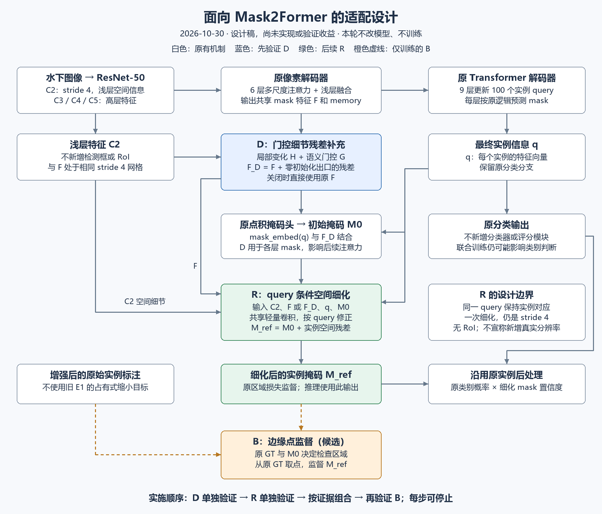

# 面向Mask2Former的细节补充、实例细化与边界监督设计

当前安排（2026-10-30）：用户要求先继续检查已有BLL为何效果不好，本设计暂缓实施。下文“先D、再R、最后B”仅保留为候选内部顺序，不是当前下一步或启动授权；当前入口见[README](../README.md)。

2026-10-30，设计稿，未实现、未验证收益。本轮只写文档与绘图，不改模型、配置、数据或权重，不训练。D/R/B是本文件的工作代号，不是已发表模块名或已确立创新。

## 1. 研究目标与决策

借鉴WaterMask的三点思想：补充细节、结合语义与空间信息逐步细化、把监督集中在需要修正的边缘。针对Mask2Former的共享像素特征与query结构重新设计，不复制原DSGAT的最远邻居稠密图或原MFRM的RoI流程。

**首个最小方案选D：浅层细节残差补充。先验证D，再单独验证R，最后才研究R输出上的B。** 不从旧E1权重继续，不同时上线三项。D主要假设是“浅层局部变化在已有融合中没有被充分用于掩码生成”；这尚未证实。其理由是接口明确、可以零扰动初始化、计算范围可控，适合先进行可证伪的低成本实验，而不是已知一定涨点。

主要目标是已有实例的范围与轮廓质量；小目标检出作为次级指标，不承诺解决背景判断、错类、query缺失或所有漏检。低分诊断仍是限制条件，不取代本研究主线。E1的失败只约束旧占有标注/监督接法，不否定细节增强与细化思想。



## 2. 原模型真实接口

依据E0实际config-resume.py与work/p3-reference/mmdet-3.3.0两个head/decoder源码；source index：mask2former_head.py的_forward_head、forward、_loss_by_feat_single；msdeformattn_pixel_decoder.py的forward。参考思想来源见[WaterMask原论文](https://openaccess.thecvf.com/content/ICCV2023/papers/Lian_WaterMask_Instance_Segmentation_for_Underwater_Imagery_ICCV_2023_paper.pdf)及既有module-transfer-review-20261029.md。以下新增公式均是本项目设计，不是原文实现。

以1024×1024画布为例，B是批次、Q=100：

| 张量 | 实际形状 | 用途 |
|---|---|---|
| C2 | B×256×256×256 | ResNet stride4浅层特征 |
| C3/C4/C5 | stride8/16/32，通道512/1024/2048 | 进入已有6层多尺度可变形encoder |
| F | B×256×256×256 | 原像素decoder融合C2和高层特征后的mask feature |
| memory | stride32/16/8，各256通道 | 原9层query decoder的输入 |
| q_l | B×100×256 | 第l层query，经原post_norm；最终q用于R |
| M_l | B×100×256×256 | 原mask_embed(q_l)与F做点积得到的掩码logits |

原模型已经有多尺度上下文和浅层融合，不能声称我们首次融合高低层。新增设计的差别须由对照证明：D明确提取并选择局部残差，R在实例条件下做空间邻域处理，而原点积head对给定query和共享F是逐位置投影。二者都仍在stride4上工作，**不声称恢复了输入中不存在的信息或新增真实空间分辨率**。

## 3. D：浅层细节残差补充，先做这一项

位置：原pixel_decoder返回F和memory之后、所有_forward_head读取mask feature之前；额外读取backbone的C2，memory保持原输出。适配时通过独立可关闭组件传递，不侵入修改原库。

明确候选计算（1×1投影无BN，避免依赖小batch统计）：

```
L = Conv1x1(C2, 256→64)
T = Conv1x1(F, 256→64)
H = L - AvgPool3x3(L)                 # stride1；有效图边缘复制，排除纯padding
G = sigmoid(Conv1x1(concat(L,T),128→64))
D = W_out(G * GELU(DWConv3x3(H)))     # 64→256，W_out权重和偏置全零初始化
F_D = F + D
M_l = einsum(mask_embed(q_l), F_D)     # 仍由原head生成每层mask
```

含义：用浅层局部变化提出细节候选，再由浅层与语义信息共同决定补充强度；不把所有纹理都增强。G是逐位置、逐通道门控，不是DSGAT或全图图注意力。高频残差也可能强调噪声和水纹，这是核心风险，必须看背景误报与空白区域响应，不只看好看的轮廓。

有效网格按img_shape/stride4向上取整，部分有效格保留；池化/卷积边界在每张图的有效矩形内处理后补回画布，纯padding增量为零。**这些是特征边界处理，不是GT占有池化。** 尺寸相同不代表忽略padding。

参数约5.84万（上述卷积含偏置58,432），不含未设计的归一化。粗略主要卷积乘加约3.8G MAC/图，未计所有逐元素操作；不是耗时实测。无N×N关系矩阵，但也不能叫零成本。

W_out=0保证初始前向F_D=F；第一步W_out可有梯度，内部投影/门控梯度初始为零是零出口的预期现象。不得同时把内部所有层也清零。关闭开关必须完全绕过分支与新增随机调用。

**影响范围说明：** F_D改变每层mask，也会数值上改变下一层的masked-attention区域，因而可能间接改变query和分类。原硬attention mask是detach路径；不能把D称作“只影响边缘、绝不影响分类”。所有原匹配和损失保持原规则，不加入E1的BLL。

## 4. R：query条件的空间残差细化，第二阶段独立验证

接在最终q与初始M0之后。D关闭时使用原F；D开启时使用F_D。没有RoI、预测框或GT框。每个query按自身索引保留同一实例身份。

```
S = Conv1x1(concat(C2,F_input),512→16)     # 每图共享，只计算一次
(gamma_q,beta_q) = Linear(q_final,256→32)
U_q = GELU((1+gamma_q)*S + beta_q + Conv1x1(sigmoid(M0_q),1→16))
delta_q = Conv1x1(GELU(DWConv3x3(U_q)),16→1)  # 最后1×1零初始化
M_ref_q = M0_q + delta_q
```

gamma/beta按空间广播；所有query共享卷积参数，但q、M0使结果实例相关。处理局部空间邻域，而不是把query向量冒充RoI空间特征。输出仍为stride4，第一版只做一次残差修正，不宣传“逐级超分辨率”。若它不能带来改善，不直接堆更多阶段。

训练时保留原所有辅助层损失、最终分类损失；**将最终层原mask BCE/Dice的预测输入替换为M_ref**，保持权重5/5及原采样规则，不额外重复加一套区域损失。匹配仍复用本次forward的原最终(q分类,M0) Hungarian结果；R不重新匹配。M0通过残差路径得到梯度。实现时需重构独立适配head的最终loss入口并复用采样，不把父类最终损失重复加回。

风险：M0匹配与M_ref质量可能偏离，需诊断真实配对变化；不未经验证默默改为重匹配。关闭R完全调用原流程；零初始化开启R时，同随机采样下最终mask损失应一致（新增R参数梯度不要求与原模型一致）。

推理对全部100 query产生M_ref，继续原分类分数/前100 query-class选择和原mask置信计算，掩码采用M_ref。同一次forward分类logits不由后置R重算，但联合训练可影响共享参数，且mask置信会改变最终分数。因此需分别记录分类、mask置信与几何质量，不能把全部AP变化归为边界改善。

资源：新增参数约1.67万，但激活不能忽略。batch2、100query、16通道、256²的一个实例特征张量约800MiB；按8query分块时单块约64MiB。**普通分块不保证训练总保存激活减少**，不能用64MiB代替总成本；若需checkpoint需另测开销与等价性。资源不合格则停止R当前实现设计，不能静默改batch/AMP破坏对照。

## 5. B：只在细化输出上的边缘点监督，最后做

借鉴边界选区思想，不复用旧E1的占有GT或decoder相邻层接法。第一阶段D和第二阶段R都不加它。

候选规则：在**实际增强后原GT像素网格**上，用5×5形态学膨胀与腐蚀之差构成双侧带（半径2输入像素）。M0.detach上采样到同一网格、阈值0.5产生预测带；两者并集且排除padding。预测带只决定哪里检查，目标始终来自GT，不能拿预测当标签。图像外部视为无效，不把裁剪外区域当负样本。

对最终原匹配的每个正query，在选区内前景/背景分别抽128点；少于128可有放回，不把一个像素扩成一个stride4前景块。坐标采用源像素中心((x+0.5)/Wpad,(y+0.5)/Hpad)，按原point_sample的align_corners=False语义分别采样M_ref和**原GT**，不要先缩成占有目标。每实例前/背景各均值再等权平均，最后对实例平均；缺少某一侧只对存在侧平均并计数，不能制造padding负样本。空匹配返回图连接零；原pipeline已过滤的空GT仍按原规则处理。

这可保证被选的微小前景点不因GT缩小而消失，但不保证stride4 logits能拟合每个极小结构；需检查梯度冲突、锯齿与原GT误差。半径2、点数256、候选权重0.1仅是待低成本验证的初始设计，不是已确定正式超参，也不从测试结果搜索值。

总损失：原辅助损失 + 原最终分类 + 原权重的最终M_ref区域BCE/Dice + lambda_B×上述边缘点BCE。不开独立边界分类头；不启用E1的loss_bll。B关闭精确回到同一R版本，B=0仍须避免改变原随机采样序列，边缘采样使用独立RNG。

这里与WaterMask不同：全图query坐标、点监督、实例/正负侧均衡。只称“借鉴边界学习的监督”，不称原BLL复现或已经改进成功。

## 6. 验证顺序与花钱前的门槛

以下全部是计划，**本轮不执行模型实现、前向或短训练**。既有已通过检查可复用与改动无关部分，不机械重新做全套。

### 第一步：D的最小机制检查

先只实现可关闭D并导出C2/F/H/G/D；输入同一固定训练图，检查张量坐标/padding、关闭等价、零初始化前向等价和有限梯度。工程数值阈值沿用已有基于原CUDA重复误差制定的协议，不能另放宽。不开R/B，不重跑正式E0。

检查噪声风险：固定人工平坦/阶跃/纹理特征检验局部算子；真实图记录GT边缘、内部与背景区域的残差响应。不能因为边缘响应大就宣称精度提升，还要比较错误边缘和背景误报。

若该检查通过，另行授权后才做短流程：在3937训练图内，以固定字符串`adaptation-design-20261030`+image_id的SHA256排序确定128图，前32张只用于接口诊断、随后64张用于短试验拟合、最后32张只用于内部观察；清单在第一次模型运行前保存，不按测试退化挑图。小样本尺寸/类别覆盖必须披露，不够时先登记协议修订，不结果出来后换图。官方train/val不移动，重复图保留；最终正式训练仍用3937张，内部观察不作为独立泛化结论。

短试验用原版控制与D各最多200步，输入/种子/初始化匹配，GPU总墙钟上限30分钟；不是复跑36轮基线，需用户单独授权，达到上限停止而非续跑。先少量计时确认预算可行。可用于检查学习方向和资源，不能据此声称正式AP提升。训练前冻结观察指标和停止理由。

### 第二步：先R独立，再决定D+R

R单独与原版比，避免把D收益算给R；接口/零初始化/关闭等价、同query匹配、实际最终loss替换、推理mask出口必须逐项检查。若R能够正常修正局部误差且成本合格，再按同样受限流程观察。D+R只在有互补依据后做，不默认凑齐三个部分。

### 第三步：B必须先过监督审计

对单像素/细线/斜线/孔洞/触边/裁剪实例检查点坐标、前背景和padding，独立计算loss/梯度；以正确、内缩、外扩掩码确认没有一味奖励膨胀。真实固定训练图检查选区图，比较R区域损失与B对同一输出的梯度范数及方向；不把全网络冲突凭局部例子定论。若再出现目标外扩、前景丢失或持续明显冲突，先停止方案，不开36轮。

### 共同资源/收益门槛

工程预算建议相对同输入原版：D推理耗时≤+15%、训练步耗时≤+20%、峰值显存≤+15%；R或组合推理≤+25%、训练≤+30%、显存≤+25%。这是项目成本上限建议，非性能预测；预热与多次测量，使用同硬件/FP32/batch，不因换精度或batch伪造改善。超限先报告取舍，不自动扩大预算。

只有工程通过、内部短流程不出现稳定的边界退化/误报恶化且有作用信号，才提交正式实验申请；小样本噪声大，不能将一个任意涨点阈值当可靠保证。没有明确作用信号则停下分析，不以“再跑36轮才知道”自动通过。

## 7. 对照、指标和论文边界

| 设计对照 | 比较对象 | 唯一要回答的问题 |
|---|---|---|
| D | 原版 | 明确的浅层残差补充是否有效？ |
| R | 原版 | query条件空间细化本身是否有效？ |
| D+R（条件） | D与R分别对照 | 是否互补而不是只有额外参数？ |
| R+B（条件） | R | 边缘点监督是否有额外作用？ |
| D+R+B（条件） | D+R | 最终组合中B的贡献是否仍存在？ |

不是默认执行全部五个36轮。旧E0保留，旧E1仅作探索历史，不复用为新B的消融。D若有效，需要一个同容量、无局部残差/门控的简单分支控制，区分设计与参数增量；先做短检查再决定是否值得正式控制实验。D失败也不自动否定独立R，反之亦然，但需另行判断预算。

正式实验仍同COCO预训练、官方3937/691、同数据/36轮/优化/种子/最终checkpoint，不用E0/E1 epoch36 warmstart新正式组。新参数初始化与源码差异登记；是否正式跑和分段停止另获授权。本方案不预先宣称统计显著，最终方法若有收益仍需配对种子验证预算。

主指标：同口径mask AP及尺寸/类别、固定阈值召回与误报、共同匹配边界IoU及覆盖率、多涂/漏涂。必须同时报告各自匹配集和共同匹配集的限制，不以只剩容易样本的均值提高冒充边界成功。若论文声称总体边界性能改善，需要补正式Boundary AP；尚未实现，不能混用已有条件均值。保留前述分类/掩码评分分项，区分几何改变和排序改变。

若D改善AP但边界下降，只能称其局部指标收益，不称边界增强成功；若B只有loss降低而真实边界退化，则拒绝该B。任何方法未获证据前都不写成论文创新。论文可围绕“浅层细节表达与query条件局部细化”组织假设，最终只保留实验支持的部分，不要求所有思想都变成独立创新点。

## 8. 本轮交付

本设计、流程图PNG/SVG及绘图脚本；README与计划入口更新。本轮仅文档/绘图静态检查与目视检查，不宣称任何工程门槛或性能门槛已通过。服务器未连接/同步；本地Git提交，远程Git由用户负责。
