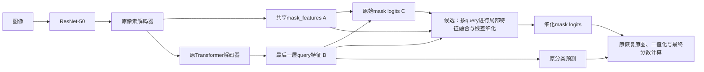

# MFRM源码与Mask2Former适配可行性审查

日期：2026-10-31。用户已明确结束独立BLL路线；本轮仅核对固定本地源码、论文和实际E0配置，不实现模块、不构建模型、不训练或连接服务器。

## 结论

原WaterMask MFRM不能直接复制接入当前Mask2Former。实例局部特征融合与掩码细化思想可以做适配，但需要新增实例空间特征、位置与坐标映射接口，属于新的query条件细化设计，尚未证明可行运行或性能收益。建议状态为“有条件的设计候选”，不把它宣布为已确定下一个训练模块。

如果继续，最合理的候选接入点是最后一层Transformer解码器生成初始mask logits之后、原推理的恢复原图/二值化/最终分数计算之前。训练也必须经过同一细化入口。不是给图像预处理加模块，不是在已经输出的二值mask上做图像修补，也不替换全部9层解码器。

此前聊天建议“优先看MFRM”指审查候选，不能推翻已有审查中“不直接迁移原模块”的结论。[2026-10-29审查](module-transfer-review-20261029.md)中的接口与资源问题仍成立；本轮基于BLL收尾重新明确可选接法，没有发现可直接照搬的证据。

## 1. 原模块实际做什么

以WaterMask mmdet2提交07042d254ffbdbf584ee0a5725e3c5e5e57e27c5的本地固定文件为主，对照f1acaafd版本，核心RoI依赖一致。来源与哈希见reports/mfrm-feasibility-20261031/source-evidence.json。本轮未声称下载或检查最新上游。

water_roi_head.py:_mask_forward先按RoI框从FPN提取局部特征，把ins_feats、全图x[0]、rois和roi_labels送入WaterMaskHead。Stage需要：

- 局部实例空间特征[N,C,h,w]，不是一个向量；
- 当前实例logits[N,1,h,w]；
- 全图细节特征[B,C,H,W]；
- 带图像索引的RoI坐标[N,5]。

Stage从全图再按同一个框RoIAlign，将两路空间特征和sigmoid掩码拼接，通过1×1卷积、膨胀率1/3/5卷积与池化融合，再减通道并阶段上采样。原配置掩码输出14→28→56，类别通道7/7/1。但默认pre_upsample_last_stage=False时，最后logits在28网格产生后插值到56，不能称最后一级有56×56可学习空间处理。

原训练按检测框裁剪GT，各阶段选择类别通道；原推理还用BMS拼接前后阶段的内部/边缘区域。原头同时包含DSGAT和BLL/BMS相关流程，不能复制整个WaterMaskHead就称“只加MFRM”。论文w/o MFRM是关闭融合功能并保留主体，论文组合内+2.5AP不等于当前Mask2Former独立加模块必涨2.5点。

## 2. 与当前模型的接口差异

| 信息 | 当前Mask2Former实际提供 | 与原MFRM的差异 |
|---|---|---|
| 空间/掩码特征A | 像素解码器mask_features，[B,256,H/4,W/4] | 全图共享，没有按实例裁剪 |
| 查询特征B | 最后一层query，[B,100,256] | 是向量，不能当作[N,C,14,14]二维实例特征 |
| 初始掩码C | mask_embed与mask_features的einsum，[B,100,H/4,W/4] | 是全图每query logits，没有检测框 |
| 实例对应 | 训练用Hungarian匹配，推理按query/类别选取 | 不等于原RoI采样和roi_labels选通道 |
| 最终预测 | 二值mask及类别概率×mask质量分数 | 细化mask即使不改分类logits，也可能改变最终分数 |

源码锚点：mmdet-3.3.0/mask2former_head.py:_forward_head（约337–377行）生成分类、mask与注意力mask；forward（约379–459行）持有mask_features与循环更新query_feat，但公共返回值只有各层分类/mask列表。要让后置细化得到A/B，需在独立适配head内部保留这些张量，不能只在当前返回的二值预测上拼模块。

## 3. 若做适配，建议接在哪里

这张图是适配候选接口图，不是原WaterMask原样实现，也不是已完成代码。只在最终层后执行一次；原中间层预测与辅助监督先保留。不加入已结束的独立BLL，不默认附带DSGAT或BMS。

较接近原MFRM的候选是：由预测mask确定带余量的局部区域，按同坐标从A提取实例空间特征；C裁到同一区域；B只作为投影后的条件信息，不能取代局部空间特征；融合后输出局部mask残差，映回同query的原logits，区域外保留原预测。输出仍是100个query的mask，不自动新增检测对象。

这里有必须先解决的条件：

1. 训练与推理都用预测定义区域，不能训练偷用GT框、推理才用预测框。GT只能用于正常监督和离线诊断。
2. 空mask、断裂区域、框外漏涂、padding与原图坐标都要明确；空query应有确定回退，局部区域不能把需修复的GT截掉。只按已预测前景紧裁会限制补漏。
3. 保留query对应关系；最小诊断可固定原最终Hungarian匹配，单独报告细化目标，不默认重新匹配或引入额外BLL。损失和正式预算尚未冻结。
4. 新残差输出可采用零初始化验证关闭/初始等价；实际学习后的影响、保存恢复与额外损失仍需验证。初始等价不保证涨点。
5. 仅向高分预测细化会影响对象覆盖，且训练若只取正query而推理取全部query会改变行为；对象选择规则必须预先确定。尚未实施。

## 4. 为什么不能承诺“放大后边界就更好”

当前mask grid为输入的stride4，1024画布即256×256。一个覆盖512像素宽的大目标在原网格横向约128格；强行压到56格再放回，可能反而损失空间细节。14→56是RoI自身网格变化，不等于比原版全图输出更精细。同一stride4特征反复插值，也不创造真实新细节。若引入stride2特征则已超出最小MFRM适配，需另审架构和资源。

将所有query广播成全图空间特征也不合适：100×256×256×256个FP32值，单图单张量6.25GiB，batch2为12.5GiB；这还不是训练总显存。局部56×56、256通道、100实例的单图单张量约306.25MiB，同样不包括卷积激活及反传。需要通道压缩、局部处理或分块，但不能据算术估算保证V100上能训练。没有本轮实测性能或显存数据。

## 5. 能解决与不能保证的事

适配后主要针对“已找到目标，但掩码区域/轮廓不准”。不能保证修复类别错误、没有合适query或候选排序退化。BLL失败不能证明E0缺MFRM。三组固定案例曾显示准确候选也可能低分，尤其不能把机器人AP下降全部当成空间细化任务。

## 6. 下一步最小检查建议

先不训练，也不直接搭完整模块。用E0已有预测和GT做局部区域与分辨率可行性审计：对已检出大目标计算预测区域是否包含需修复的GT、空/断裂情况，以及不同局部网格下的GT裁剪/还原损失。区域始终由预测定义，GT仅衡量覆盖与上限。它可以先在本地完成，不能把oracle还原成绩当模型性能。

只有确认局部区域不严重截断、网格不明显降低大目标表达，才值得实现可关闭的单阶段残差接口并做无训练前向/反向检查。若这一步就不合适，应停止该候选，而不是为了使用MFRM名字新增检测框分支或直接开训。本轮仅提出这一步，未运行该审计或实现模块。
