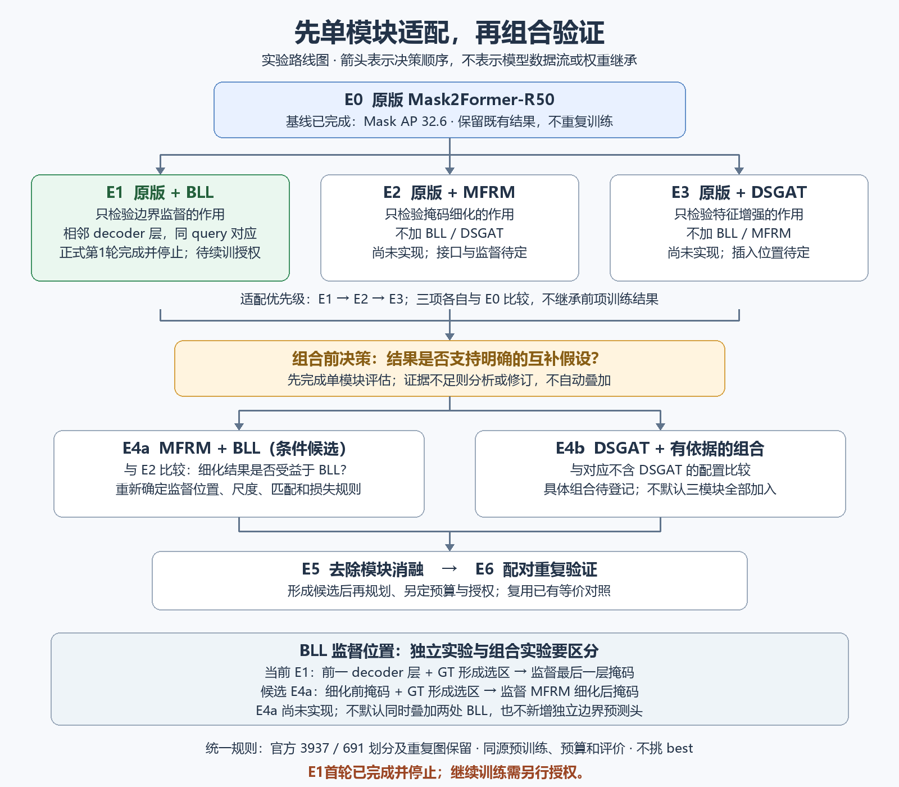

# 单模块适配与组合验证计划

2026-10-22状态更新：E1正式首轮1969步已完成并停止，验收通过，未继续第2轮；详见[e1-first-epoch-result.md](e1-first-epoch-result.md)。以下路线本身不授权自动启动后续实验。

2026-10-22，经用户确认：先单模块适配、再组合验证。本次只更新计划和图，不授权训练。此文件与README第2节统一使用E0–E6编号，E1具体配置仍以e1-bll-training-plan.md为准。

图中箭头表示实验决策与依赖，不表示模型数据流或checkpoint继承。绿色是已完成工程适配，蓝色为已有基线，灰色为尚未实现的计划，橙色为条件决策。可编辑版本为同目录SVG，生成源码为scripts/draw-module-roadmap.py。

## 实验编号、顺序与比较对象

| 编号 | 配置 | 主要比较 / 要回答的问题 | 状态与进入条件 |
| --- | --- | --- | --- |
| E0 | 原Mask2Former-R50 | 固定对照，mask AP32.6/AP50 47.6/AP75 35.3 | 已完成，不重训、不覆盖 |
| E1 | 原版＋独立BLL | 对E0：仅增加边界监督是否有效？ | 正式第1轮完成并停止，验收通过；后续轮次需另获授权 |
| E2 | 原版＋MFRM适配，不加BLL/DSGAT | 对E0：细化模块本身是否有效？ | 未实现；先核对原模块、确定接口和监督，再完成工程验证 |
| E3 | 原版＋DSGAT适配，不加BLL/MFRM | 对E0：特征增强本身是否有效？ | 未实现；具体插入位置待源码与特征接口核对 |
| E4a | 原版＋MFRM＋BLL | 对E2：BLL对细化结果的额外作用；并列报告E0/E1 | 条件候选；前述单模块评估后登记组合假设与新BLL协议 |
| E4b | DSGAT＋有依据的模块组合 | 对对应不含DSGAT的配置：是否存在互补收益？ | 条件候选；具体组合与子编号实施前登记，不默认全部三模块 |
| E5 | 最终组合逐项去除模块 | 每个保留模块贡献是什么？ | 仅当形成多模块候选时；已有同配置结果可复用，避免重复训练 |
| E6 | E0与最终候选的配对重复 | 单次提升能否稳定复现？ | 后续另定种子和预算、另获授权；不自动重训当前E0 |

执行优先级为E1→E2→E3，再根据证据决定是否执行E4a/E4b；这不是无人值守连续训练指令。每个模块都依次经过来源/接口核对、实现、关闭等价及开启功能检查、必要的数据/梯度/保存恢复和短流程检查，再冻结协议、获准正式训练、评估。检查按改动范围选择，不机械重复已通过的无关步骤。某项不可行时记录理由并更新计划，不为了完成表格强行训练。

## 三个模块的适配边界

**E1独立BLL：** 使用原decoder倒数第二层与最后一层的同query掩码，复用最终层原匹配。额外监督最后层；全部原损失保留，不新增细化分支或可学习参数、不改推理。GT使用块内前景占有和有效半格规则，width3/weight1。当前183→0是我们适配版本的标注保留修正，不是与WaterMask原版的精度比较。

**E2独立MFRM：** A空间/掩码特征、B查询特征、C初始掩码作为待核对的接口候选，不视为已实现设计。先核对原MFRM的运算和输入输出，再确定如何将RoI式处理迁移到query实例、输出尺度、实例关联、原掩码与细化掩码的监督和推理使用方式。E2须有不依赖BLL的可训练监督；若框架需要改写原损失或预测出口，必须显式登记并审查对照公平性，不能偷加其他模块。

**E3独立DSGAT：** 先核对原结构、通道和尺度，再确定在Mask2Former特征链的位置；旧PPT的“像素解码器内部”只是候选。单模块验证中不加入MFRM或BLL，不能假定现有多尺度特征可以直接接入。

## MFRM与BLL如何组合

E4a的候选关系是：初始掩码→MFRM→细化掩码；用细化前预测和GT产生边界选区，对细化后的掩码施加额外BLL。这比当前decoder相邻层方案更接近阶段细化思路，但接口和效果尚未验证。

开始E4a前必须冻结：前后预测的query/GT对应、是否保留同一匹配、GT生成尺度、有效区域、边界带宽、权重、归一化、梯度路径，以及E2原监督/推理是否保持一致。不能默认复用256×256、width3/weight1或块占有规则在新输出上的效果。默认只研究这一处细化BLL，不同时叠加E1的decoder BLL；如果两处同时加，必须另立实验编号和对照。

E4a与E2的差异才用于解释“细化后的BLL”的贡献；E4a与E1的差值同时含结构和监督位置变化，不能单独归因于MFRM。若要直接声称“迁移BLL监督位置更优”，需增加位置对照，不用现有四组结果代替。

## 统一实验规则与决策

所有首轮对照保留官方3937/691划分及重复图，沿用E0同一COCO初始化来源、seed、36轮预算、增强/优化及最后轮次选模。E0是结构和结果参照，**不是新实验初始化权重**；不从E0 epoch36、E1结果或技术试跑checkpoint串行继续。新参数初始化和必要接口差异在各自协议登记。

指标同时看mask AP、AP50/AP75、尺寸/类别、同口径条件边界诊断与覆盖率，记录耗时/显存/推理变化。条件边界分数不是Boundary AP，测试反馈、单种子限制和官方重复图必须披露。负结果保留；不挑best、不换数据规则救结果。

组合需有明确互补假设及已审查的单模块结果，不默认穷举。单模块无整体提升不自动排除一切交互，但若仍拟组合，须先说明具体依据、额外比较对象与成本，再决定是否执行，不能用“可能互补”掩盖失败。

## 与旧PPT的关系及当前下一步

旧PPT是可能的组合终点草图，不是当前已实现结构，也不是固定实现规范。当前仅E1独立BLL适配完成工程检查；MFRM、DSGAT、BMS和独立边界预测分支均未实现。BLL在边界选区内监督前景/背景掩码值，不应画成独立边界分类头。

当前E1首轮已完成并停止，后续只有在用户另行授权后核对现场资源/同一协议，从epoch_1继续；不重复第一轮。E2/E3及组合按本计划分别推进，不自动启动。
