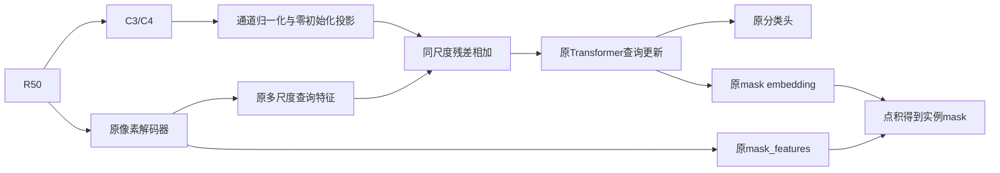

# R50中层特征直连查询解码器：候选设计与验证

日期2026-11-01。下文为执行前设计。用户后续已授权无训练接入验收，现已通过，见[验收结果](direct-query-integration-result-20261101.md)；没有参数更新或训练。依据feature-readout-result-20261101.md；不恢复DiveSeg、BLL、简单有效区域采样、邻居辅助query或MFRM计划。

## 建议及证据边界

建议只保留一个候选：将R50 C3/C4经轻量投影，以残差形式加入查询解码器原本读取的stride8/16 memory。原骨干、pixel decoder、100query、9层解码器及预测头保留，原损失/匹配/输入尺度不变。先验证直接提供中层线索是否有价值，不同时加监督、边界头、query数量或注意力范围修改。

理由：GT128/129/130的C3/C4有可读几何；GT66/67在现有mask_features上有比原query更好的读出。这支持研究“信息利用”，不证明原融合丢信息，也不证明直接通路必然有效。GT124/126的探针校准失败禁止将其作为pixel decoder信息丢失证据。14GT仅是开发案例，不能作为训练目标、超参选择集或独立泛化成绩。

原版已经将C3/C4用于多尺度像素解码和query attention；新意假设是保留融合前特征的直接访问路径，不是第一次使用多尺度，也不是第一次让query交互。源码依据：本地reports/feature-readout-export-20261101/head-source.txt及[MMDetection v3.3.0 head](https://github.com/open-mmlab/mmdetection/blob/v3.3.0/mmdet/models/dense_heads/mask2former_head.py)。[Mask2Former原论文](https://arxiv.org/abs/2112.01527)已有预测mask限制cross-attention的机制。

## 接在哪里、如何计算

原调用：x=model.extract_feat(inputs)，x为C2/C3/C4/C5；pixel_decoder(x)得到mask_features和memory列表，memory依次stride32/16/8。head.forward中decoder_input_projs之后、flatten/level_embed之前插入残差：

```text
D32 = 原project(memory32)
D16 = 原project(memory16) + W4 · LN_channel(C4)
D8  = 原project(memory8)  + W3 · LN_channel(C3)
```

LN_channel为每个空间位置沿通道的无仿射LayerNorm，eps=1e-5；W3/W4为无bias的1×1卷积，512→256和1024→256，权重全部初始化为0。参数新增393216个（约0.393M），无新增token，无第二套attention。该数来自当前R50维度，实际实现时再按state_dict核对。

不用“零gate乘零投影”的双零设计，以免两者首步梯度同时为零。只有投影权重零初始化；初始化状态输出回到原模型，但不能据此保证训练后不退化。不要在后续通用初始化中意外覆盖新增权重的零值。

原stride32支不动；stride16/8在9层中各访问3次，合计影响6次query更新。位置编码、层编码和原attention mask保持原逻辑；形状应天然对齐，若不一致先报错，不擅自插值修补。默认开关关闭；开启后新增投影按原head学习率组训练，不把它误放进backbone的0.1倍组。原R50学习率和BN设置保持一致。



这一步改的是query看到的信息，更新后的query共同产生分类与mask embedding，不在最终mask后修边，不增加BLL。原mask_features分支保持原结构；在未来训练中其参数仍按原基线规则更新，并非承诺训练后特征完全不变。

## 预期及明确失败可能

期望查询更准确对应独立目标，减少多涂和多个实例混合，并让几何改善伴随正确类别分数。不能只看GT最佳IoU或选中案例变好。

可能完全无收益的原因：原memory已经足够包含这些信息；拟合向量使用GT而query无法自行获得；原硬attention门仍可能限制访问；相同类别的邻居也可能被增强而多涂更多；如果mask_features确实不能表达某目标，单改query不直接修复表达空间；新增参数也可能扰动大目标。这些都是待验证机制，不能当已查清原因。

本方案只优先检验“直接信息通路”的一个因素。若失败，停止该候选，不自动扩成C2/C3/C4全加、解锁注意力门、双分支mask或继续调损失。

## 怎么验证：分清工程正确与效果正确

### A. 无训练接入验收（尚未执行）

若用户后续授权实现，先用已有3图/14GT缓存验收：

- 关闭分支与原版输出、loss一致；开启但W=0时300条既有输出同样复现。FP32确定性前向以原有误差规则核验，不能为通过临时放宽。
- E0原键完整加载，仅允许新增投影键缺失；原层参数逐项一致。独立配置/输出目录，不覆盖E0。
- 在既有真实训练图固定两个不同尺寸样本上各做一次原loss反向，检查W3/W4梯度有限且非零、原参数无更新；零梯度则先定位，不开训。仅反向检查，不创建优化器或step。
- 保存/加载带新增键的模型参数，核验恢复后前向一致；测单图显存及耗时。冻结效率上限为相对同输入原版推理耗时+10%、峰值显存+15%，超过则暂停设计。无实测前不承诺“几乎零成本”。
- 合成输入可检查只有C3/C4对应memory发生残差变化、所有尺度/有效位置对齐；不把随机激活分支后的IoU当收益测试。

这阶段只证明接对，零初始化必然无AP增益，不能借此决定有效。

### B. 以后获授权才做一次同预算AP筛查

首选复用已经完成的原版追加3轮A作为对照，但必须逐项核验能否复用：同E0起点、新优化器、LR1e-5、backbone0.1倍、batch2、FP32、5907步、数据顺序/增强种子/评价入口一致；新增模块初始化后重新设置训练RNG以免建模消耗随机数改变数据流。不能只因都叫“3轮”就认定一致。已有A的AP32.8929、小目标8.1122、大目标48.1538。

若这些条件及记录无法证明一致，应在另获训练授权后重做配对A/B；本设计不自动要求重跑A，也不使用旧A掩盖不同设置。正式冻结训练协议时明确是否复用、全部配置与实际预算，本轮不生成可开训入口。

候选B只打开直接通路，其余保持一致。固定epoch3，不选最佳epoch；691图使用同一原始GT/重复图/800-1333测试尺度/100输出/COCOeval规则，统一评价总AP、APs/APm/APl、分类别AP。14GT只作机制附表，不能替代全量结果。

继续门槛（相对有效的同预算A）：总AP至少+0.5且不低于E0；小目标AP至少+0.5；大目标AP不低于max(A,E0)-0.3。若复用已有A，则对应AP≥33.3929、APs≥8.6122、APl≥47.8538。记录中目标与每类退化，不能用三门槛掩盖明显类别崩溃。只有单种子通过也只能叫值得复验，不能叫稳定提升。

未通过就停止该候选，不追加到36轮。通过后才单独讨论复验/完整训练预算。若总体AP不升，即使可视化、小目标案例或梯度看起来更好也不算成功。

### C. 如果真有收益，如何证明是直接特征而非多参数

收益成立后，再比较“只对原memory增加同参数量残差适配”的对照，分清直接C3/C4内容和增加参数两种因素。拟定stride8为256→256→256、stride16为256→512→256的两层无bias线性投影，不加激活，第一层正常初始化、第二层零初始化；新增参数分别131072/262144，总计393216，与本候选一致，同网格投影乘加量也一致。输入只来自原memory，不访问直接C3/C4。该对照为因子化投影，与单层旁路的优化参数化不同，归一化计算也不同；不能称所有因素完全相同，需报告局限。

再按需比较C3-only、C4-only与两者组合。上述均是收益成立后的归因需求，当前不排队启动这些训练。直接skip/projection属于常见结构思想，本方案未完成相似工作检索，不能称首次或足够论文创新。即使提升AP，也需依据消融和问题特异性评估论文价值。

## 当前产出与下一项

本轮完成针对现有R50的单候选设计与验证/止损要求；无实现、参数更新、新推理或服务器操作。下一项最多是上述无训练接入验收，并不意味着必须训练。所有历史结果和官方划分不变，Git本地提交，用户负责推送。
